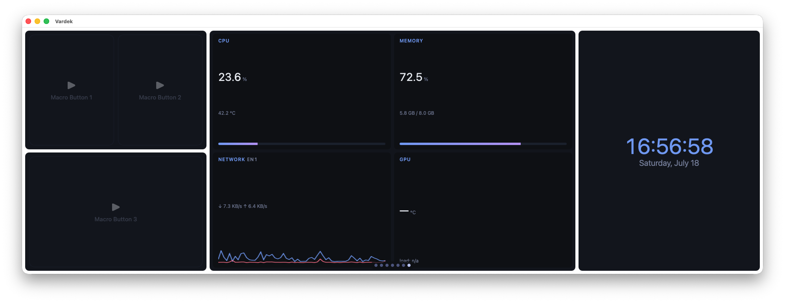
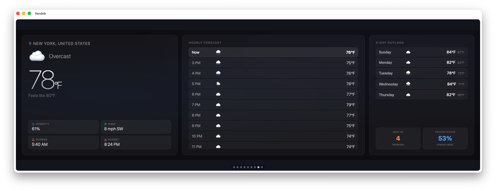
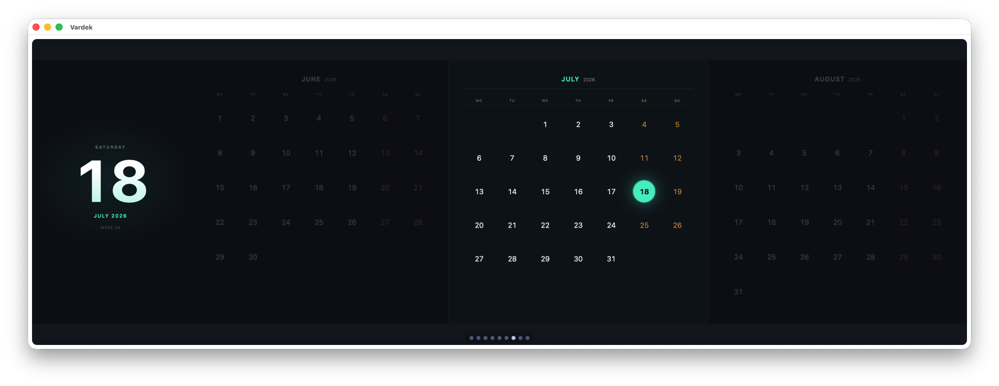
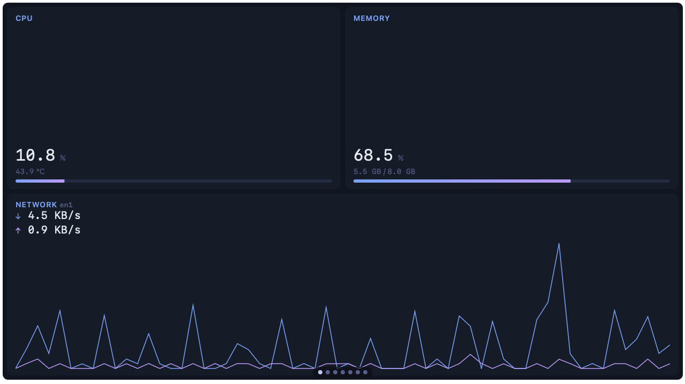
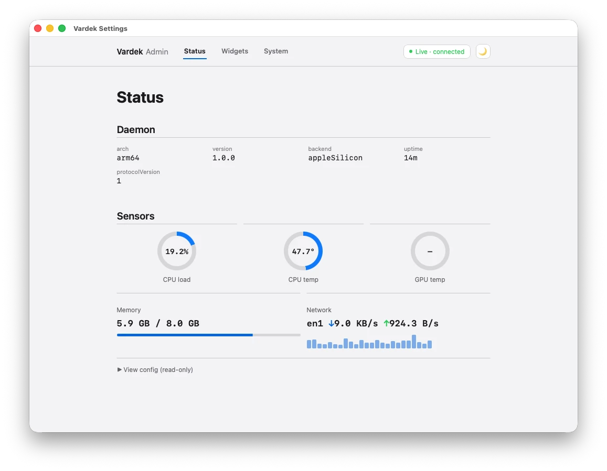
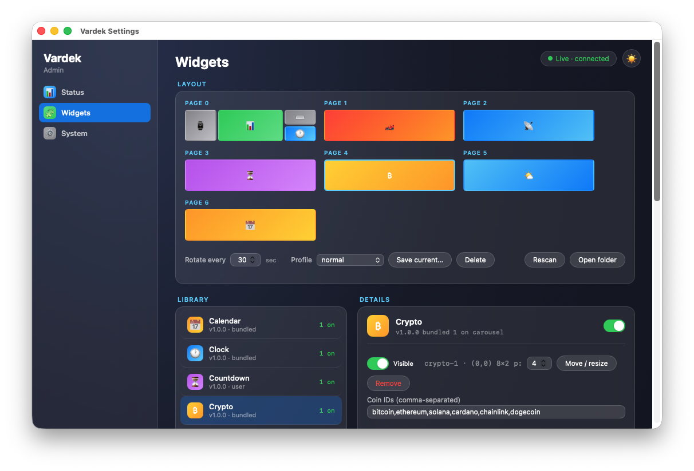
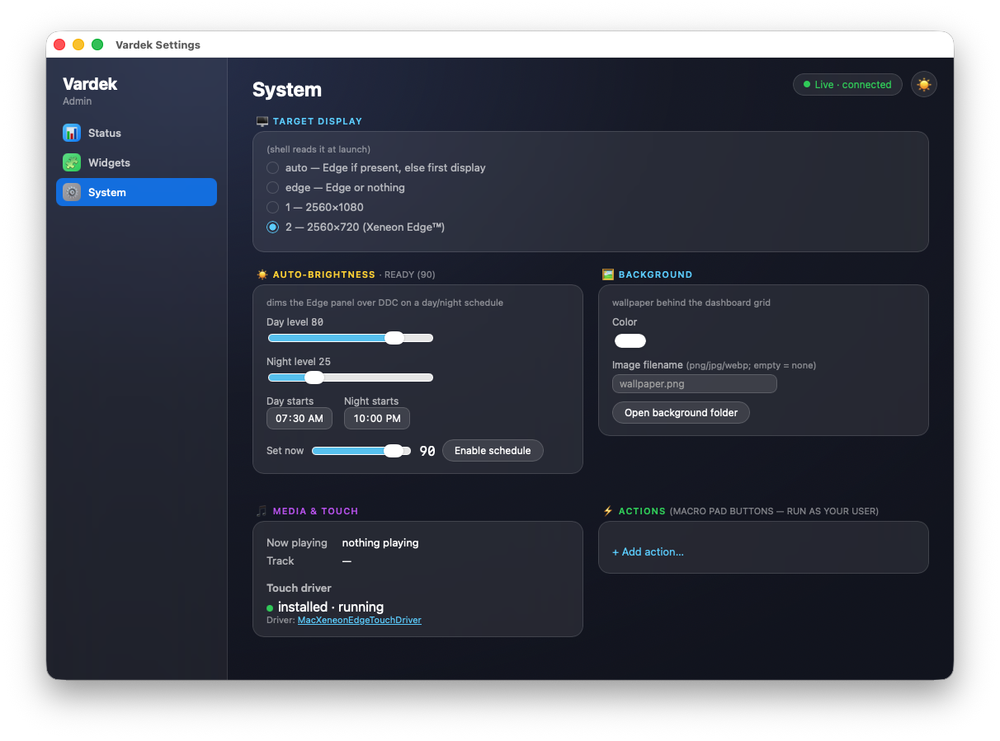

# Vardek

A local, Mac-native widget dashboard for the **Corsair Xeneon Edge™** touchscreen
(the 2560×720 USB-C secondary panel).

**Website:** [vardek.app](https://vardek.app) · **Download:** [latest release](https://github.com/vardekapp/Vardek/releases/latest) · **vs iCUE:** [comparison](https://vardek.app/vs-icue/)

> [!IMPORTANT]
> **Upgrading to 1.0.23?** From 1.0.19 or later, install the new app and check
> [three small changes](#upgrading-to-1023). Upgrading from 1.0.18 or earlier, the
> add-on widgets were renamed and must be reinstalled — follow the
> [upgrade steps](#upgrading-to-1023) below.



## What it is

Corsair ships the Xeneon Edge™ widget layer only for Windows, through iCUE. On
macOS the 2560×720 panel arrives as a blank second display. Vardek rebuilds
that widget layer natively for the Mac: a full-screen, touch-driven grid of
six bundled widgets plus any Vardek-format add-on you drop in, running
entirely on your machine. Free, macOS 13+, signed and notarized by Apple.

## Local-first

Whatever can run on your machine does. Clocks, the day/night terminator,
life-progress bars, and more are pure local math with no network at all; others
(like the ISS tracker) fetch only a tiny bit of data and compute the rest
on-device. When a widget does need live data — weather, launches, earthquakes —
it makes only the exact API calls its manifest lists, and nothing else leaves
your Mac. API keys live in the macOS Keychain, never in a plaintext config file.

## Requirements

- macOS 13 (Ventura) or later
- Apple Silicon Mac (CPU/GPU temperature sensors are Apple Silicon-only)
- A Corsair Xeneon Edge™ over USB-C (optional — Vardek also runs on any display
  so you can try it)

## Install

1. Download `Vardek-<version>.dmg` from the [latest release](https://github.com/vardekapp/Vardek/releases/latest).
2. Open it and drag **Vardek** to **Applications**.
3. Launch Vardek. The app is signed and notarized by Apple.

Verify the download against `SHA256SUMS.txt` (attached to each release) if you like:

```
shasum -a 256 -c SHA256SUMS.txt
```

## Upgrading to 1.0.23

<a name="upgrading-to-1022"></a>
<a name="upgrading-to-1021"></a>
<a name="upgrading-to-1020"></a>
**Install the app.** Quit Vardek, open `Vardek-1.0.23.dmg`, and drag **Vardek**
into **Applications**, replacing the old copy. Open Vardek.

**Coming from 1.0.19, 1.0.20, 1.0.21 or 1.0.22?** Installing is all you need; your
pages, settings and approvals carry over. Three things behave differently:

- **Revoking an add-on deletes the keys saved for it** (Admin says so first).
  If you approve it again later, enter its keys again.
- **Your own widgets:** an ID may use only letters, digits, `_`, `.` and `-`,
  must not start with `.`, and is at most 128 characters; secret key names may
  use only letters, digits and `_`. A widget that doesn't qualify is listed with
  the reason in **Admin → Widgets**.
- **Profile names** can no longer contain `/` or `\`; existing ones that do are
  renamed automatically.

From 1.0.21 or earlier, auto-brightness is built in: if you installed `m1ddc`
only for Vardek you can remove it (`brew uninstall m1ddc`).

<a name="upgrading-to-1019"></a>
**Coming from 1.0.18 or earlier?** Do these steps too:

1. **Reinstall your add-on widgets.** Add-ons from
   [vardekapp/vardek-widgets](https://github.com/vardekapp/vardek-widgets) were
   renamed from `com.vardek.<name>` to `app.vardek.<name>` in 1.0.19, and the old
   copies will not load.
   1. Get the latest add-ons:
      `git clone https://github.com/vardekapp/vardek-widgets` (or `git pull` in your
      existing copy).
   2. Install each add-on you use:
      `./install-addon.sh app.vardek.<name>` — for example
      `./install-addon.sh app.vardek.world-clocks`. This also removes the old
      `com.vardek.<name>` copy.
      *Manual alternative:* copy the `app.vardek.<name>` folder into
      `~/Library/Application Support/Vardek/widgets/` and delete the old
      `com.vardek.<name>` folder.
   3. In Vardek, open **Admin** (⌘A) → **Widgets** and click **Rescan**.
   4. Click **Approve** on each add-on.

   Widgets you had already placed on your pages switch to the renamed add-on
   automatically and keep their settings.
2. **UniFi Network or Flight Tracker users:** open the widget's settings in
   Admin and enter your API key again. Keys saved under the old add-on name are
   not carried over.
3. **Your own widgets:** widget IDs starting with `com.vardek.` or
   `installation.` are reserved and won't load. Give your widget a different ID
   (for example `com.yourname.mywidget`), then Rescan and Approve.

**Coming from 1.0.17 or earlier?** Also read
[What changed in 1.0.18](#what-changed-in-1018): Admin opens only inside the app
(⌘A — the browser Admin at `127.0.0.1:8137` is gone), and every user-installed
widget must be approved once in Admin.

## Documentation

- [Setup](docs/setup.md) — install and first launch.
- [Mac display setup](https://vardek.app/mac-setup/) — recommended window sizes if you don't have a Xeneon Edge.
- [Touch setup](docs/touch-driver.md) — enable the touchscreen (community driver).
- [Troubleshooting](docs/troubleshooting.md) — common fixes.
- [Widget authoring guide](https://vardek.app/widgets/authoring/) — build your own widget.
- **In-app Help** (Vardek menu → Help, or ⌘?) — per-widget help pages, kept in sync with each widget's current behavior.

## Widgets

Six widgets ship bundled, curated and fixed at install. Drop your own into
`~/Library/Application Support/Vardek/widgets/`, press **Rescan** in Admin →
Widgets, and approve it once — no app update needed. Widget IDs starting with
`com.vardek.` are reserved for the bundled widgets; your own widgets need a
different ID.

**Add-on widgets:** install more after the fact — no app update — from
**[vardekapp/vardek-widgets](https://github.com/vardekapp/vardek-widgets)**.
That repo is open source; grab a widget, drop it in the folder above (or run its
`install-addon.sh`), press **Rescan**, and approve it in Admin. Official add-ons
use `app.vardek.*` IDs since 1.0.19.
[Authoring guide](https://vardek.app/widgets/authoring/) and PRs welcome there too.

**Community add-ons:** [kevinelliott/vardek-widgets](https://github.com/kevinelliott/vardek-widgets)
by Kevin Elliott — a separate, community-maintained collection of 100+
add-on widgets (clocks, weather, space, finance, aviation, generative art).
Always review any public widget before installing; install same as any
add-on widget above.

| | |
|---|---|
|  |  |
| **Weather** — current conditions, hourly, and a five-day outlook | **Calendar** — hero date with a three-month grid, instant first paint |
|  | |
| **System Sensors** — CPU, memory, and network instruments that go amber past real thresholds and dim when data stops | |

**Also bundled:** **Clock** (time, kept honest by local math with no network at
all), **Sensor Gauge** (one sensor, one dial — pick the reading that matters),
and **Macro Pad** (touch buttons on the panel, wired to what you run most) —
see them live in-app (⌘? → per-widget Help) or via the ⌘A Admin panel.

## Admin

Manage everything from the Admin panel — open it as an app window (**Vardek menu →
Open Admin**, ⌘A). Placement,
settings, sensors, brightness, profiles — no config files to hand-edit.

Arranging the panel is direct manipulation: **drag widgets onto a live page map**
(or between pages, or onto a "New page" target), resize with per-widget size
chips, and filter the library as you type. The whole editor also works from the
keyboard, removals ask first and offer a 10-second **Undo**, and every change
confirms with a "Saved ✓" pulse.

| | |
|---|---|
|  |  |
| **Status** — daemon, panel, and live sensors at a glance | **Widgets** — arrange pages, browse the library, set options |
|  | |
| **System** — display, day/night brightness, touch-driver status | |

## Questions

<details>
<summary><strong>Does the Corsair Xeneon Edge work on a Mac?</strong></summary>
<br>

The panel does. Over USB-C or HDMI, macOS sees the Xeneon Edge™ as an ordinary
2560×720 second display. The widget layer does not: Corsair delivers that
through iCUE on Windows. On macOS the panel is a blank strip of desktop until
you run something on it. Vardek is what runs on it — see the
[full iCUE vs Vardek comparison](https://vardek.app/vs-icue/).
</details>

<details>
<summary><strong>Does Vardek send my data anywhere?</strong></summary>
<br>

No. The daemon opens no network port at all; it runs as a signature-verified
child process of the app and talks to it over private pipes. No
cloud, no account, no telemetry. The only network traffic is the API calls a
data widget explicitly makes, and those go through an audited proxy limited to
hosts the widget declares in its manifest. Full detail on the
[privacy page](https://vardek.app/privacy/).
</details>

<details>
<summary><strong>Can Vardek use iCUE widgets?</strong></summary>
<br>

Not directly. Building an iCUE widget today means installing Corsair's
WidgetBuilder CLI, scaffolding and validating the widget with it, then
packaging it into a `.icuewidget` file that gets imported through iCUE's own
**+** button — a manifest schema (`author`, `preview_icon`,
`supported_devices`, …) and config model (`<meta name="x-icue-property">`
tags, `onICUEInitialized`) built for iCUE only. Vardek widgets are a plain
folder — `manifest.json` plus `index.html`, no CLI, no packaging step, no
iCUE install required. Community add-ons built for Vardek install by dropping
the folder into the widgets folder, rescan, approve once in Admin — see the
[widget authoring guide](https://vardek.app/widgets/authoring/).
</details>

<details>
<summary><strong>How much does Vardek cost?</strong></summary>
<br>

Nothing. Vardek is free, closed source, and distributed as a signed and
notarized DMG through GitHub Releases. No paid tier, no subscription, no
account.
</details>

<details>
<summary><strong>Do I need a Xeneon Edge to run Vardek?</strong></summary>
<br>

No. Vardek runs full-screen on any macOS display, so you can try it before the
Edge™ arrives. The layout is built for the panel's 2560×720 shape and reads
best there, but nothing requires that hardware.
</details>

## What changed in 1.0.23

Security hardening release. Full notes on the
[release page](https://github.com/vardekapp/Vardek/releases/tag/v1.0.23).

- **Macro Pad actions are bound to their pad:** a Macro Pad can show and run
  only the actions listed for it. The separate, unused route that ran actions
  was removed.
- **One Admin check:** every request only Settings makes (brightness, power,
  update check, sensors, system info, rescan, profiles, background) must carry
  the Admin marker, through a single gate that a test enforces for new routes.
- **Paths are decoded exactly once**, so a crafted name like `a%2541` can't
  select a different image, profile or action than the one requested.
- **One rule for widget IDs and key names**, shared by the app and its helper,
  including case-insensitive protection of the reserved `com.vardek.` prefix.
- **Approvals and keys are decided in one place:** approving an add-on can no
  longer delete the keys of a newer version that appeared at the same moment.
- **Keys don't outlive their widget:** Revoke deletes an installation's keys,
  and keys of a widget folder gone for 7 days are removed.
- **No blank credentials:** a widget whose API key you haven't entered gets an
  error instead of sending an empty key to the provider.
- **Background images** are read through a single no-follow file handle; links,
  hard links, pipes and files over 50 MB are refused.

See [Upgrading to 1.0.23](#upgrading-to-1023) for what to check after installing.

## What changed in 1.0.22

Security hardening release. Full notes on the
[release page](https://github.com/vardekapp/Vardek/releases/tag/v1.0.22).

- **Strict Content Security Policy** for the dashboard, Settings and Help: only
  Vardek's own script files can run where the app's private helper connection is
  available. Those pages are loaded into memory from the signed app at launch.
- **Private settings files:** `config.json` and the approval list are readable
  only by your account, with crash-safe saves.
- **Approve and Revoke ask first**, listing the widget, its fingerprint, the
  sites it can contact and its key names. Approving a new add-on version deletes
  keys saved for older versions.
- **Auto-brightness no longer needs `m1ddc`.**
- Leftover pre-1.0.18 loopback code removed; release builds are checked against
  the exact signing identity and permissions before notarization.

See [Upgrading to 1.0.23](#upgrading-to-1023) for what to check after installing.

## What changed in 1.0.21

Fix release. Full notes on the
[release page](https://github.com/vardekapp/Vardek/releases/tag/v1.0.21).

- **Help works again.** Since 1.0.18 every Help page showed "Failed to load …
  Error: 404" because page names contain spaces. Background images and widget
  files with spaces in their names are fixed too.
- **Stricter file paths** on the app's private connection to its background
  helper: `.` and `..` segments, plain or encoded, are refused.

See [Upgrading to 1.0.23](#upgrading-to-1023) for what to check after installing.

## What changed in 1.0.20

Reliability release; no security boundary changed. Full notes on the
[release page](https://github.com/vardekapp/Vardek/releases/tag/v1.0.20).

- **Recovers on its own.** If Vardek's background helper stops or stops
  responding, the app restarts it automatically (with the same signature checks
  as at launch) and shows "Reconnecting…"; after repeated failures it shows a
  **Restart** button instead of a dead screen. One slow request no longer takes
  the panel down, and the dashboard reloads itself after a web-content crash.
- **No lost settings.** A save based on settings that changed elsewhere is
  refused with a clear message instead of overwriting them, and Undo only undoes
  the one thing you removed.
- **Swipes don't press buttons.** Swiping or scrolling across the Macro Pad (or
  any tappable item) no longer also taps it.
- **Weather never sticks on "Loading…"**; errors show a tap-to-retry message.
- **Finder's `.DS_Store` files are ignored** in the widgets folder instead of
  causing a scan error or cancelling a widget's approval.

See [Upgrading to 1.0.23](#upgrading-to-1023) for what to check after installing.

## What changed in 1.0.19

Security release; every user should update. Full notes on the
[release page](https://github.com/vardekapp/Vardek/releases/tag/v1.0.19).

- **Tighter widget network rules.** A widget's allowed destinations are checked
  by exact host and port, private and reserved network addresses are blocked in
  every form (including IPv6 transition addresses), request headers must be
  well-formed, and upstream cookies never reach a widget.
- **Sturdier daemon.** Malformed widget requests are rejected with an error
  instead of stopping the app's background process.
- **Limits on widgets.** Each widget has a message budget; only visible widgets
  can change pages or ask to open a link, and after you cancel a link the same
  widget has to wait before asking again.
- **Official add-ons renamed to `app.vardek.*`** so they load again (1.0.18
  reserved the old `com.vardek.*` names for built-in widgets).

See [Upgrading to 1.0.23](#upgrading-to-1023) for what to do after installing.

## What changed in 1.0.18

Security release. Full notes on the
[release page](https://github.com/vardekapp/Vardek/releases/tag/v1.0.18).

- **No network port.** The daemon no longer listens on `127.0.0.1:8137`. The app
  launches it over private pipes and both sides verify the other's Developer ID
  signature before any settings or Keychain data are opened.
- **Admin is in-app only.** ⌘A or Vardek menu → Open Admin. Browser Admin is gone.
- **Widget approval.** User-installed widgets must be approved once in Admin
  before they can use the network proxy or a stored key. Changed files or
  permissions ask again. Keys are scoped to the approved widget; on upgrade,
  Vardek offers to migrate existing keys and leaves them untouched if you decline.
- **Hardened widget runtime.** Response-level sandbox/CSP on every widget
  document, hash-pinned scripts (no inline `onclick`/`onerror`), no navigation
  inside widget documents, external links need a native confirmation.
- **Bounded work.** Proxy requests and Macro Pad actions are rate-limited per
  widget and globally; a failed update check now says so instead of "up to date".

## Privacy

Local-only by design. Since 1.0.18 nothing listens on any port, not even
loopback: the app launches its daemon as a child process and the two talk over
private pipes after verifying each other's code signature. The only traffic that leaves your Mac is the specific
API call a widget you enable makes (e.g. Weather fetching a forecast), limited
to the exact hosts that widget declares. Full details at
[vardek.app/privacy](https://vardek.app/privacy/).

## License

Vardek is proprietary and **not open source** — the source that builds these
releases isn't published. What that license *doesn't* do: no telemetry, no
account, no DRM or anti-tamper clause, free forever. Binary builds are free to
use under the End User License Agreement bundled with the app. See
[`LICENSE`](LICENSE) and [`THIRD-PARTY-NOTICES.md`](THIRD-PARTY-NOTICES.md).

"Corsair" and "Xeneon" are trademarks of their respective owner; Vardek
references them only for hardware compatibility and is not affiliated with or
endorsed by Corsair.
